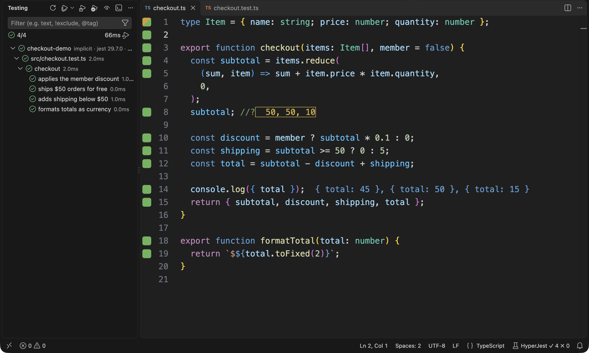
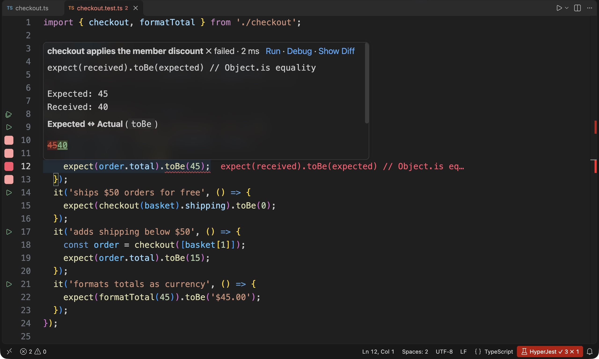

<div>
    <center>
    
    <h1>HyperJest</h1>
    </center>
</div>

[](https://marketplace.visualstudio.com/items?itemName=GuyCarmeli.hyperjest)


HyperJest is a VS Code extension that runs your project's own Jest and shows test feedback as you code.

- **Run the tests that matter.** HyperJest uses per-test coverage to rerun affected tests as you type or save.
- **Spot coverage and failures.** Gutter marks show coverage, and failures appear inline.
- **Inspect live values.** `console.log` output and `//?` values appear beside your code.

## See it in action

See which lines your tests cover and inspect runtime values without leaving the editor. Gutter marks show coverage, `//?` comments reveal expression values, and `console.log` output appears beside the code that produced it. Test Explorer keeps test results in view.



Find failures where they happen. HyperJest highlights failing assertions and the code paths they execute. Use **HyperJest: Show Line Details** to compare expected and actual values, rerun or debug the test, or open the diff.



## Installation

Install [HyperJest from the VS Code Marketplace](https://marketplace.visualstudio.com/items?itemName=GuyCarmeli.hyperjest), or search for **HyperJest** by **GuyCarmeli** in VS Code's Extensions view and click **Install**. You need VS Code 1.134 or later and Node.js 22 or later.

You can also install it from the command line if the VS Code `code` command is on your PATH:

```bash
code --install-extension GuyCarmeli.hyperjest
```

Open a project with Jest installed in its package; HyperJest discovers its Jest configuration and starts eligible tests automatically. Use **HyperJest: Select Configurations** if you have multiple packages or configurations.

For configuration options, see [Configuration](docs/configuration.md). For building from source and troubleshooting commands, see the [maintainer guide](CLAUDE.md).

## Jest compatibility

HyperJest supports **Jest 28, 29, and 30**, using the Jest version installed in your project. CI tests a pinned version of each major.

Older versions may work but aren't officially supported. Jest prereleases aren't supported. See the [compatibility policy](scripts/jest-compatibility.json) for the exact versions tested.

HyperJest is released under the [MIT license](LICENSE.md).
